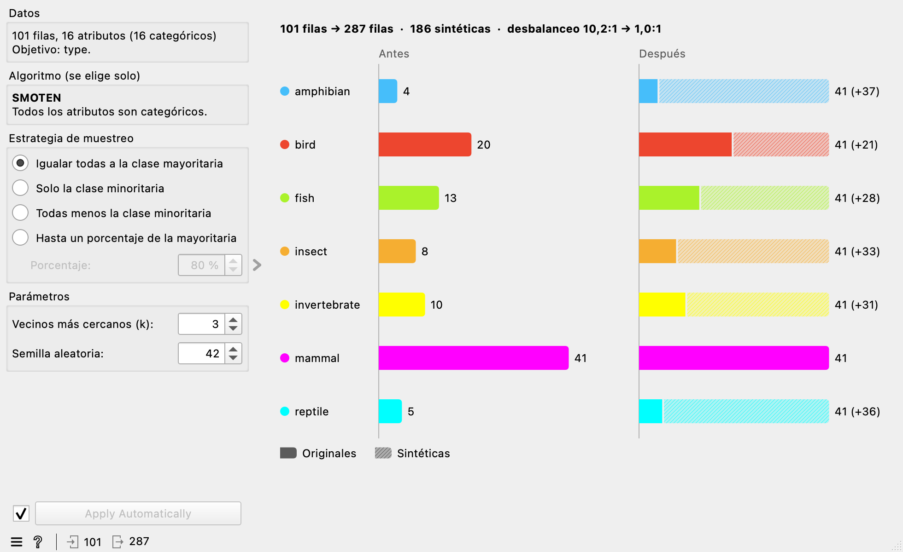
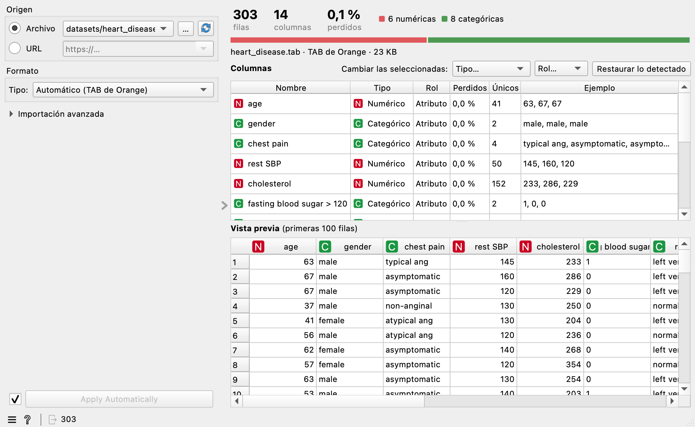
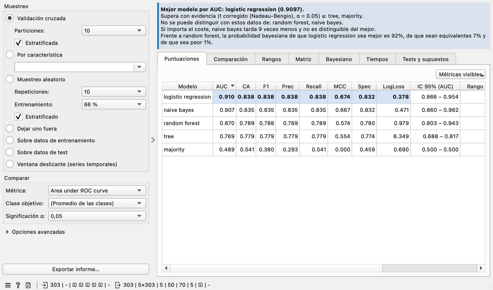
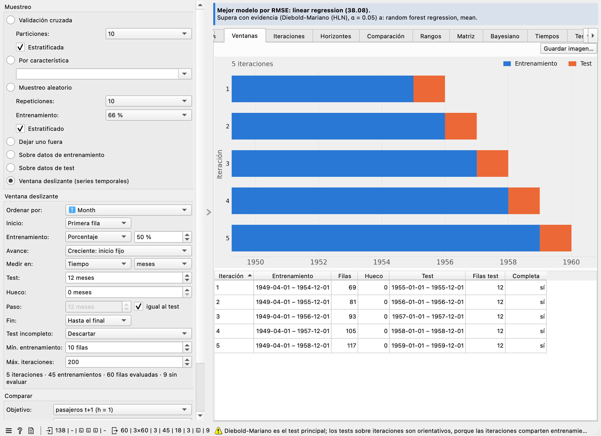
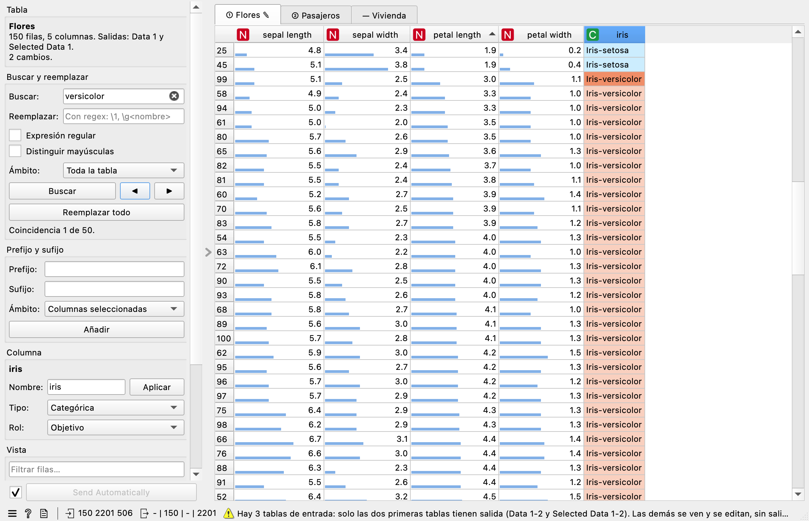

# orange_gualbe_toolbox

<p align="center">
  <a href="https://doi.org/10.5281/zenodo.24144757"></a>
</p>

Utilidades visuales de ciencia de datos para Orange Data Mining.

Add-on para [Orange Data Mining](https://orangedatamining.com/) con la categoría
de widgets **Toolbox Gualbe**.

## Instalación

Desde Orange: menú **Options → Add-ons…**, botón **Add more…**, escribe
`orange_gualbe_toolbox` y reinicia Orange.

O con `pip`, en el mismo entorno de Python que Orange:

```bash
pip install orange_gualbe_toolbox
```

## Widgets

Todos los widgets son visuales, con valores por defecto sensatos y su ayuda en
español (F1 o icono **?**).

| Widget | Qué hace |
|---|---|
| **SMOTE** | Balancea las clases generando instancias sintéticas de las minoritarias. Muestra la distribución antes y después. |
| **File Import** | Importa datos desde un archivo o una URL (CSV, TSV, TAB, XLS/XLSX y ARFF) con vista previa y edición de columnas. |
| **Test & Score Pro** | Evalúa modelos como Test & Score y los compara con tests estadísticos rigurosos, gráficos e informe exportable. |
| **Data Table Pro** | Muestra varias tablas en pestañas y las edita como una hoja de cálculo: ordenar, reordenar columnas, editar, buscar y reemplazar, tipos y roles, con salidas numeradas. |

### SMOTE

<p align="center">
  
</p>

Recibe una tabla con variable objetivo categórica y devuelve la misma tabla, con
sus filas originales intactas, más las instancias sintéticas al final.

- **Elige el algoritmo solo**: `SMOTE` con atributos numéricos, `SMOTENC` con
  atributos mixtos y `SMOTEN` si todos son categóricos.
- **Estrategias**: igualar todas las clases a la mayoritaria, solo la minoritaria,
  todas menos la minoritaria o llegar a un porcentaje de la mayoritaria.
- **Reproducible**: número de vecinos *k* y semilla aleatoria configurables.
- En las filas sintéticas las metas quedan desconocidas y, si la tabla tiene
  pesos, el peso es 1.
- Trabaja en segundo plano y explica en el propio widget qué hacer si faltan
  valores, si una clase tiene pocas instancias o si no hay nada que balancear.

Balancea solo los datos de entrenamiento: las filas sintéticas en el conjunto de
prueba darían una evaluación demasiado optimista.

### File Import

<p align="center">
  
</p>

Reúne en un solo widget lo mejor de **File** y **CSV File Import** de Orange.

- **Origen**: archivo local (con recientes y arrastrar y soltar) o URL http/https.
- **Formatos**: CSV, TSV, TAB de Orange, XLS, XLSX y ARFF, también comprimidos. El
  formato, la codificación, el separador y la cabecera se detectan solos.
- **Vista previa** al instante, leyendo solo el principio del archivo.
- **Columnas**: nombre, tipo y rol editables, también varias a la vez, sin volver a
  leer el archivo.
- **Importación avanzada** plegada: codificación, separador, comillas, decimales,
  miles, filas a saltar, cabecera, valores perdidos, comentarios y máximo de filas.
- **Rápido y robusto**: carga en segundo plano y cancelable con el motor C de
  pandas, y mensajes claros ante archivos vacíos o dañados, filas irregulares, Excel
  con contraseña, URL con errores o que devuelven una página web, etc.

Las opciones y las ediciones se guardan con el workflow.

### Test & Score Pro

<p align="center">
  
</p>

Parte de **Test & Score** de Orange, con sus mismas entradas, muestreos y salidas (y uno más, la
ventana deslizante), y responde
a la pregunta clave: ¿la diferencia entre modelos es real o se debe al azar?

- **Tests rigurosos**: t corregido de Nadeau-Bengio y t bayesiano correlacionado (las particiones
  de una validación cruzada no son independientes), Wilcoxon, Friedman con Nemenyi y Holm, McNemar,
  corrección por comparaciones múltiples, tamaños de efecto e intervalos de confianza.
- **Cada test dice en qué se apoya** y avisa si no se cumple.
- **Gráficos**: distribución por particiones, diferencias críticas, matriz de comparaciones y
  probabilidades bayesianas, exportables como imagen.
- **Recomendación** del mejor modelo, justificada, en lenguaje llano.
- **Salidas adicionales**: puntuaciones por modelo, por partición y por horizonte, comparaciones,
  rangos y mejor modelo.
- **Ventana deslizante para series temporales**: entrena con el pasado y evalúa con el bloque
  siguiente, con entrenamiento creciente o de tamaño fijo, test, hueco y paso en filas o en tiempo,
  inicio y fin por fecha y vista previa de las ventanas. Con varias variables objetivo compara los
  modelos en cada **horizonte**, y los compara con el test de **Diebold-Mariano**.
- **Informe** autocontenido en HTML o PDF, reproducible.
- En segundo plano y cancelable. Cambiar la métrica o los tests no vuelve a entrenar.

<p align="center">
  
</p>

### Data Table Pro

<p align="center">
  
</p>

Parte del **Data Table** de Orange y lo convierte en un editor de tablas:

- **Varias tablas**, cada una en su pestaña. Salidas numeradas **Data 1…5** (tabla completa con
  los cambios) y **Selected Data 1…5** (filas seleccionadas), en el orden de las pestañas, que
  llevan el número de su salida (①, ②…). Cada salida se llama como el nodo de origen.
- **Ordenar** pulsando una columna (ascendente, descendente y vuelta al orden original) y
  **reordenar columnas** arrastrando la cabecera: las salidas respetan los dos órdenes.
- **Editar celdas** con validación por tipo, y **deshacer y rehacer** (Ctrl+Z, Ctrl+Y).
- **Buscar y reemplazar**, también con expresiones regulares y grupos, distinguiendo o no
  mayúsculas, en toda la tabla, en las columnas o en las filas seleccionadas, con las
  coincidencias resaltadas.
- **Prefijo y sufijo** en columnas de texto y categóricas.
- **Renombrar columnas** y cambiar su **tipo** (categórica, numérica, fecha y hora, texto) y su
  **rol** (atributo, objetivo, meta), con varios objetivos; las conversiones fallidas se cuentan.
- **Vista**: filtro rápido de filas, barras en las numéricas, colores de las categóricas, celdas
  editadas resaltadas, colores propios de fondo y de texto, estadísticas de cada columna en su
  cabecera y copiar al portapapeles.
- Los cambios se **guardan con el workflow** y se repiten mientras la entrada no cambie.
- Pensado para tablas grandes: con 300.000 filas, abrir, ordenar, convertir o reemplazar en una
  columna tardan menos de un segundo, y buscar en toda la tabla, unos 2 segundos la primera vez.
- Solo reenvía las salidas que cambian, para no recalcular lo que cuelga del nodo.

## Ayuda de los widgets

La ayuda (F1 / icono "?") se genera con Sphinx dentro del propio paquete y debe
reconstruirse antes de empaquetar:

```bash
pip install sphinx
python -m sphinx -b html doc orangecontrib/orange_gualbe_toolbox/_help/html
```

## Mantenimiento y publicación en PyPI

Este repositorio es la **fuente de verdad** del add-on. La publicación en
[PyPI](https://pypi.org/project/orange-gualbe-toolbox/) es automática mediante
[Trusted Publishing](https://docs.pypi.org/trusted-publishers/): al publicar una
release `vX.Y.Z` en GitHub, el workflow `.github/workflows/publish.yml` genera la
ayuda, construye el paquete, lo sube a PyPI y adjunta los ficheros a la release.
El workflow rechaza la publicación si la etiqueta no coincide con la versión de
`pyproject.toml`.

## Licencia y autoría

**Autor:** Gualberto Asencio Cortés · Copyright © 2026.

`orange_gualbe_toolbox` es software libre bajo la licencia
[GPL-3.0-or-later](https://github.com/gualbe/orange_gualbe_toolbox/blob/main/LICENSE)
(GNU GPL versión 3 o posterior), la misma familia de licencia que Orange, del que
el add-on importa y hereda clases y del que adapta algunas partes.

Además, al amparo del artículo 7 de la GPL-3, el fichero
[`NOTICE`](https://github.com/gualbe/orange_gualbe_toolbox/blob/main/NOTICE) añade
unos términos adicionales que se aplican al material del autor:

- **Atribución (7 b):** toda copia o versión modificada, completa o parcial, debe
  conservar el aviso de copyright y la atribución de autoría a Gualberto Asencio
  Cortés en los ficheros fuente, en la documentación y en `NOTICE`.
- **Origen y versiones modificadas (7 c):** no se puede falsear el origen del
  material; las versiones modificadas deben marcarse como distintas del original
  y no pueden presentarse como el add-on original ni como publicadas o
  respaldadas por su autor.
- **Nombres (7 e):** no se concede ningún derecho sobre los nombres
  «orange_gualbe», «Orange Gualbe» ni «Gualbe».

**Forks y versiones derivadas.** Puedes estudiar, modificar y redistribuir el
código en los términos de la GPL-3, pero si distribuyes una versión modificada
debes publicarla con otro nombre de paquete y de proyecto (que no contenga esos
nombres), indicar que es una versión modificada de `orange_gualbe_toolbox` y no
presentarla como oficial ni como obra del autor.

**Cómo citar.** Cita el add-on con su DOI general de Zenodo,
[10.5281/zenodo.24144757](https://doi.org/10.5281/zenodo.24144757), que remite siempre a la última versión (cada
release tiene además su propio DOI en Zenodo). Si usas el add-on en un trabajo
académico, puedes tomar los metadatos de
[`CITATION.cff`](https://github.com/gualbe/orange_gualbe_toolbox/blob/main/CITATION.cff)
(GitHub ofrece «Cite this repository» con el formato APA o BibTeX), por ejemplo:

> Asencio Cortés, G. (2026). *orange_gualbe_toolbox: utilidades visuales de ciencia
> de datos para Orange Data Mining* (versión 0.5.3) [Software]. Zenodo.
> https://doi.org/10.5281/zenodo.24144757

**Componentes de terceros.** El add-on depende de Orange Data Mining (GPL-3.0 o
posterior, Bioinformatics Laboratory, Universidad de Liubliana), imbalanced-learn
(MIT), scikit-learn, pandas, NumPy y SciPy (BSD-3-Clause), openpyxl (MIT), xlrd
(BSD), baycomp (MIT) y Matplotlib (licencia de Matplotlib), que se instalan aparte.
Algunas partes están adaptadas del código de Orange: la gestión de modelos y
muestreos de Test & Score Pro (de Test & Score), el bucle de evaluación de la
ventana deslizante (de `Validation`), la lista de archivos recientes y el arrastrar
y soltar de File Import (de File) y la lectura del nombre de un archivo descargado
(de `Orange.data.io`). Conservan el copyright y la licencia de Orange y los términos
adicionales no se les aplican; [`NOTICE`](https://github.com/gualbe/orange_gualbe_toolbox/blob/main/NOTICE)
detalla qué ficheros y qué partes son. Los iconos de los widgets son originales.
