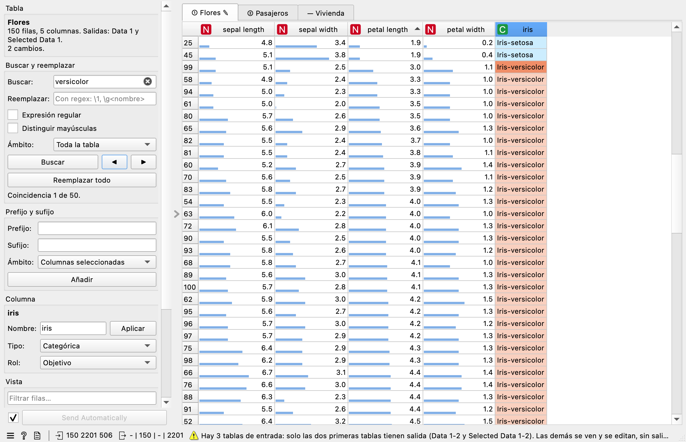

.. _data table pro:

Data Table Pro
==============

Muestra varias tablas a la vez, cada una en su pestaña, y permite cambiarlas como en una
hoja de cálculo: ordenar filas, reordenar columnas, editar celdas, buscar y reemplazar,
añadir prefijos y sufijos, renombrar columnas y cambiar su tipo y su rol. Cada tabla, con
todos sus cambios, sale por su propia salida numerada.

Entradas
--------

- **Data**: una o varias tablas. Conecta tantas como quieras: cada enlace abre una pestaña.

Salidas numeradas
-----------------

Orange no permite salidas con un nombre que cambie según lo conectado, así que el widget
tiene **cinco pares de salidas numeradas**, en el orden de las pestañas:

.. list-table::
   :header-rows: 1
   :widths: 25 75

   * - Salida
     - Qué lleva
   * - **Data 1** … **Data 5**
     - La tabla completa de la pestaña 1 … 5, con todos los cambios y en el orden de filas y
       columnas que se ve. El filtro rápido no la recorta.
   * - **Selected Data 1** … **Selected Data 5**
     - Las filas seleccionadas en esa pestaña, con los mismos cambios. Sin selección no envía
       nada, como el Data Table de Orange.

El número de cada pestaña aparece en un distintivo: **①**, **②**… La pestaña ① va a
*Data 1* y *Selected Data 1*, la ② a *Data 2* y *Selected Data 2*, etc. El panel *Tabla*
lo repite para la pestaña abierta y el ratón sobre la pestaña también lo dice.

Cada tabla de salida se llama como el **nodo del que viene** (por ejemplo «Flores» si el
nodo *File* se ha renombrado así) o, si no se puede saber, como la tabla de entrada. Así es
fácil reconocerla después en otros widgets.

- Con **más de cinco** entradas, las que pasan de cinco se ven y se pueden editar, pero no
  tienen salida: el widget lo avisa y su pestaña lleva «—» en lugar de número.
- Al **quitar un enlace**, las pestañas siguientes suben un puesto y sus salidas también; la
  última salida que queda libre se vacía.

**Ejemplo.** Conecta dos *File* (renombrados «Clientes» y «Pedidos») a Data Table Pro.
Corrige en «Clientes» los códigos postales mal escritos con *Buscar y reemplazar* y conecta
*Data 1* a *Merge Data* y *Data 2* a su segunda entrada: el cruce usa ya los datos corregidos.

Ordenar y reordenar
-------------------

- **Ordenar filas**: pulsa el nombre de una columna; ordena de menor a mayor y, si vuelves a
  pulsar, de mayor a menor. La ordenación es estable: para ordenar por dos columnas, pulsa
  primero la secundaria y después la principal. Los valores desconocidos quedan al final.
  **Orden original** vuelve al orden de la entrada (también en el menú de la cabecera).
- **Reordenar columnas**: arrastra su cabecera. Las salidas usan el nuevo orden, sin mezclar
  atributos, objetivos y metas: cada grupo se ordena por separado.

El número a la izquierda de cada fila es el de la fila en la tabla de entrada, así que
siempre se ve de dónde viene.

Editar celdas
-------------

Doble clic (o empieza a escribir) en una celda. El valor se comprueba según el tipo:

- **Numérica**: acepta punto o coma decimal. Un texto que no es un número se rechaza con un
  aviso que dice por qué.
- **Categórica**: un valor nuevo se añade a los valores de la columna.
- **Fecha y hora**: formatos como ``2026-11-13`` o ``2026-11-13 09:30``.
- **Texto**: cualquier valor.

Dejar la celda vacía o escribir ``?`` la deja como valor desconocido. Las celdas cambiadas se
resaltan en amarillo y la pestaña lleva ✎.

El editor muestra el número **con toda su precisión** aunque la celda lo redondee (por ejemplo
``3.14159265358`` en una celda que muestra ``3.14159``), así que abrir una celda y confirmarla sin
tocarla no cambia nada ni cuenta como edición. En una columna de fechas, una hora escrita sin zona
se toma en la zona horaria de la columna, y si se escribe una hora en una columna que solo tenía
fechas, la columna pasa a mostrar también la hora.

**Deshacer y rehacer**: **Ctrl+Z** y **Ctrl+Y** (o los botones del panel *Cambios*) deshacen y
rehacen ediciones, reemplazos, prefijos, cambios de nombre, de tipo y de rol, hasta 50 pasos.
También se pueden deshacer los cambios que se han repetido al abrir un workflow guardado.

Buscar y reemplazar
-------------------

Escribe el texto y pulsa **Buscar** (o Intro). Todas las coincidencias se resaltan en naranja y
la actual en naranja intenso; **◀** y **▶** (o **Mayús+F3** y **F3**) van a la anterior y a la
siguiente. **Reemplazar todo** cambia todas y dice cuántos reemplazos ha hecho y en cuántas
celdas.

- **Expresión regular**: usa la sintaxis de Python. En el reemplazo, ``\1``, ``\2``… o
  ``\g<nombre>`` insertan los grupos. Por ejemplo, buscar ``^(\w+), (\w+)$`` y reemplazar por
  ``\2 \1`` convierte «García, Ana» en «Ana García».
- **Distinguir mayúsculas**: si no se marca, «madrid» encuentra «Madrid».
- **Ámbito**: toda la tabla, las columnas seleccionadas o las filas seleccionadas. **Con el filtro
  rápido activo, solo cuentan las filas visibles**, y el ámbito lo dice («Filas visibles (filtro)»).

Se busca y se reemplaza en el **texto que se ve** en cada celda. En una numérica, si la coincidencia
es el texto visible entero (``3.14159`` → ``2``), el resultado es el número del reemplazo; si es una
parte, el reemplazo se aplica al texto visible. Las celdas sin coincidencia no se tocan y conservan
todos sus decimales, y tampoco se toca una celda cuyo número no cambia. Si una celda se veía
redondeada (por ejemplo ``3.14159`` cuando vale ``3.14159265358``) y el reemplazo la reescribe, pierde
los decimales que no se veían: el widget lo avisa con el número de celdas afectadas y **Ctrl+Z** lo
deshace. En una columna numérica o de fecha, un reemplazo que no da un valor válido se rechaza y el
widget dice cuántos. En una categórica, el valor nuevo ocupa el lugar del antiguo en la lista de
valores, y reemplazar por nada o por ``?`` deja el valor como desconocido.

Prefijo y sufijo
----------------

Añade un texto delante, detrás o en los dos lados de cada celda del ámbito (columnas
seleccionadas, filas seleccionadas o toda la tabla). Se aplica a columnas de **texto** y
**categóricas**. Las **numéricas y de fecha no se tocan**, porque «Nº 5» ya no sería un número:
el widget dice cuáles se han saltado. Si quieres cambiarlas, conviértelas antes a texto. Las
celdas vacías tampoco se tocan.

Columnas: nombre, tipo y rol
----------------------------

Selecciona una celda de la columna o la columna entera (menú de la cabecera → *Seleccionar la
columna*). En el panel *Columna*:

- **Nombre**: escribe el nuevo y pulsa *Aplicar* o Intro. No puede repetirse.
- **Tipo**: categórica, numérica, fecha y hora o texto. Si algunos valores no se pueden
  convertir (por ejemplo «tres» a número), pasan a desconocidos y el widget dice cuántos y en
  qué columna. Un número convertido a fecha se toma como segundos desde 1970. Una columna de
  texto siempre es meta, como exige Orange.
- **Rol**: atributo, objetivo o meta. Se admiten **varios objetivos**.

Si hay varias columnas enteras seleccionadas, el tipo y el rol se aplican a todas.

La cabecera de cada columna muestra su tipo con un icono y, al pasar el ratón, sus
estadísticas: desconocidos, mínimo, máximo, media, mediana y desviación típica en las
numéricas y los valores más frecuentes en las categóricas.

Vista
-----

- **Filtrar filas**: muestra solo las filas que contienen el texto en alguna columna. *Data N*
  sigue llevando todas las filas, pero buscar, reemplazar y el prefijo y sufijo actúan solo
  sobre las filas visibles mientras el filtro esté activo.
- **Seleccionar filas completas**: si se desmarca, se seleccionan celdas sueltas y *Selected
  Data N* lleva solo las columnas seleccionadas.
- **Barras en las columnas numéricas**: una barra bajo cada valor, proporcional a su posición
  entre el mínimo y el máximo de la columna.
- **Colores de las categóricas**: el color de cada valor, como en los gráficos de Orange.
- **Resaltar celdas editadas**.

Las columnas objetivo se tiñen de azul y las metas de gris. Con el botón derecho sobre la tabla
puedes **copiar** la selección (también Ctrl+C, como texto tabulado que se pega en una hoja de
cálculo) y dar un **color de fondo o de texto** a las filas, columnas o celdas seleccionadas.

Cambios guardados
-----------------

Los cambios de cada pestaña (ediciones, reemplazos, nombres, tipos, roles, orden y colores) se
guardan con el workflow, con el nombre de la pestaña y una huella de **todo** el contenido de la
tabla (todas sus celdas). Al volver a abrirlo:

- si llega la misma tabla (mismas columnas, mismo número de filas y mismos datos), se repiten y se
  pueden deshacer;
- si se ha renombrado el nodo de origen, se reconocen por el contenido, una vez han llegado todas
  las entradas, y se aplican igual. Si hay varias pestañas con la misma tabla y no se puede saber de
  cuál eran, no se aplican y el widget lo avisa. Esto solo ocurre cuando se carga la pestaña: una
  pestaña que ya estaba abierta, o que ya tiene cambios propios (aunque solo sea un orden), nunca
  recibe los cambios de otra, por ejemplo al quitar un enlace;
- si la tabla ha cambiado, aunque tenga la misma forma, se descartan con un aviso, para no aplicar
  ediciones a filas equivocadas;
- si hay cambios guardados que no corresponden a ninguna entrada conectada, el widget lo avisa y
  los conserva por si vuelve a conectarse esa tabla.

Los avisos de cada pestaña se mantienen aunque lleguen otras entradas. **Restablecer** descarta
todos los cambios de la pestaña abierta.

Cuando cambia algo, el widget solo vuelve a enviar las salidas afectadas: al seleccionar, solo
*Selected Data N* de esa pestaña; al editar, las de esa pestaña. Así no se recalcula todo lo que
cuelga del nodo.

Tablas grandes
--------------

La vista solo lee las celdas que se ven y las operaciones trabajan por columnas enteras. Medido
con 300.000 filas y diez columnas en un portátil:

- abrir la tabla, ordenar, convertir de tipo (también fechas) o reemplazar en una columna: menos de
  medio segundo;
- reemplazar en 150.000 filas seleccionadas de diez columnas: menos de un segundo;
- buscar en toda la tabla: unos 2 segundos la primera vez y menos de 1 las siguientes (los textos se
  guardan hasta el siguiente cambio);
- filtrar: menos de un segundo;
- la huella solo se calcula cuando hace falta (al comparar con cambios guardados o al guardar
  cambios): centésimas de segundo con 300.000 filas numéricas, y unas décimas con una tabla de
  2.000 × 20.000, una dispersa enorme o 300.000 filas con textos largos.

Una tabla dispersa se muestra y se emite como densa (el widget
lo avisa) siempre que no supere 50 millones de celdas.
