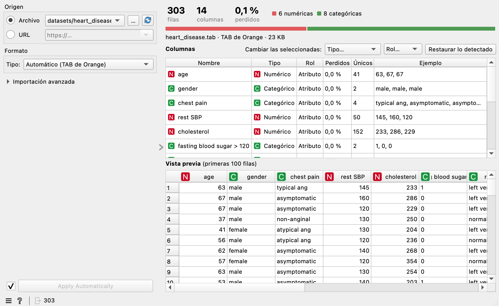

.. _file import:

File Import
===========

Importa una tabla de datos desde un archivo o una URL, con vista previa y edición
de columnas. Reúne en un solo widget lo mejor de **File** y **CSV File Import**.

Para qué sirve
--------------

Elige un origen y el widget deduce todo lo demás: formato, codificación,
separador, cabecera, tipos y roles. Si algo no es como esperabas, lo corriges a la
vista y la vista previa cambia al momento.

Salidas
-------

- **Data**: la tabla importada.

Origen
------

- **Archivo**: elige uno de los recientes o ábrelo con **…**. También puedes
  arrastrarlo a la ventana del widget. El botón de recarga vuelve a leerlo.
- **URL**: escribe una dirección http o https y pulsa Intro. Los enlaces para
  compartir de Google Sheets, Google Drive y Dropbox se convierten solos en
  descargas directas.

Formatos
--------

El formato se deduce del **contenido** del archivo y, en su defecto, de la
extensión. Si no coinciden, manda el contenido y el widget lo avisa. Puedes
corregirlo en **Tipo**.

.. list-table::
   :header-rows: 1
   :widths: 22 78

   * - Formato
     - Notas
   * - **CSV** y **TSV**
     - Texto delimitado. Separador detectado automáticamente.
   * - **TAB de Orange**
     - Reconoce la cabecera de tres filas (nombres, tipos y roles) y los prefijos
       del tipo ``cD#nombre``. La columna de pesos se importa como meta.
   * - **Excel** (XLSX y XLS)
     - Elige la hoja. Si la primera está vacía, se usa la siguiente. El valor de una
       celda combinada se copia a todas las que abarca, y los errores como
       ``#N/A`` son valores perdidos.
   * - **ARFF**
     - Numéricos, nominales, fechas, textos, ``?`` y formato disperso. La última
       columna nominal, o la llamada ``class``, se toma como clase.

Los archivos de texto también pueden estar comprimidos (gzip, bzip2, xz o un ZIP
con un solo archivo).

Columnas
--------

Cada columna del archivo es una fila de la tabla, con su número de valores
perdidos, de valores distintos y unos ejemplos. Haz clic para cambiar:

- **Nombre**.
- **Tipo**: numérico, categórico, texto o fecha.
- **Rol**: atributo, clase, meta u omitir. El texto siempre es meta, porque Orange
  no admite texto como atributo.

Para cambiar varias a la vez, selecciónalas y usa **Cambiar las seleccionadas**.
**Restaurar lo detectado** deshace todas las ediciones. Editar columnas nunca
vuelve a leer el archivo: el cambio es inmediato aunque la tabla sea grande.

Cómo se deducen los tipos:

- Los textos con hasta 100 valores distintos (y pocos respecto a las filas) son
  **categóricos**; los demás, **texto**.
- Los enteros con solo dos valores (por ejemplo 0 y 1) son **categóricos**, igual
  que en File. El resto de números son **numéricos**.
- Si al menos el 95 % de una columna son números, es **numérica**, y lo que no
  encaja queda como perdido, con un aviso que dice cuántos son.
- Una columna llamada ``class``, ``clase``, ``target`` u ``objetivo`` se propone
  como **clase**.
- Las columnas totalmente vacías se **omiten** con un aviso; puedes recuperarlas.

Importación avanzada
--------------------

Está plegada para no estorbar. Cada opción muestra entre paréntesis lo detectado.

.. list-table::
   :header-rows: 1
   :widths: 28 72

   * - Opción
     - Qué hace
   * - **Codificación**
     - Se detecta (incluido el BOM). Si el archivo no es UTF-8 de principio a fin, se
       lee como Windows-1252 y se avisa. También puedes escribir cualquier otra.
   * - **Separador** y **Comillas**
     - Carácter entre campos y carácter que protege un campo.
   * - **Decimal** y **Miles**
     - Admite decimales con coma y separadores de miles.
   * - **Saltar filas**
     - Líneas iniciales que se ignoran.
   * - **Cabecera**
     - Automática, sin cabecera (las columnas se llaman *Columna 1*, *Columna 2*…) o en
       una fila concreta, contada después de las saltadas.
   * - **Valores perdidos**
     - Textos que cuentan como perdidos, separados por comas. La celda vacía siempre
       lo es.
   * - **Comentarios**
     - Las líneas que empiezan por este carácter se ignoran.
   * - **Máximo de filas**
     - Lee solo las primeras filas.
   * - **Orden de fechas**
     - Para fechas ambiguas. En automático gana el formato que mejor encaja y, si
       empatan, día/mes/año.
   * - **Descarga máxima**
     - Tamaño máximo que se descargará desde una URL. Por defecto, 500 MB. También
       fija el máximo de lo descomprimido (ver abajo).

Vista previa y carga
--------------------

La vista previa lee solo el principio del archivo y muestra las primeras 100 filas
tal como quedarán. Con **Apply Automatically** activo, la carga completa empieza
sola después. Si lo desactivas, ajusta todo con calma y pulsa **Apply**.

La lectura va en segundo plano con barra de progreso, y **Cancelar** la detiene.

Lo que ocurre cuando hay problemas
----------------------------------

.. list-table::
   :header-rows: 1
   :widths: 40 60

   * - Situación
     - Qué hace el widget
   * - Filas con campos de más o de menos
     - Conserva la fila (recorta lo sobrante o deja perdido lo que falta) e informa de
       cuántas son y de la primera.
   * - Nombres de columna repetidos o vacíos
     - Los renombra (``a (2)``, ``Columna 3``) y lo indica.
   * - Separador ambiguo
     - Usa el más probable y dice cuál otro encaja.
   * - Valores que no encajan con el tipo, fechas imposibles
     - Quedan como perdidos e informa de cuántos son y en qué columnas.
   * - Números enormes o infinitos
     - Los infinitos pasan a perdidos. Si un número pierde precisión, recomienda usar el
       tipo texto (típico de identificadores largos).
   * - Fechas anteriores a 1677 o posteriores a 2262
     - No se pueden representar: quedan como perdidas, con aviso.
   * - Comillas sin cerrar
     - Mensaje con la fila donde empiezan. Se puede desactivar el uso de comillas.
   * - Archivo vacío, inexistente, sin permisos o dañado; Excel con contraseña
     - Mensaje claro y sin salida.
   * - URL con error, redirección excesiva, tiempo agotado, demasiado grande, que
       descomprime demasiado o que devuelve una página web
     - Mensaje claro y sin salida. Solo se admiten http y https, también en las
       redirecciones.

Datos comprimidos desde una URL
-------------------------------

Un archivo comprimido muy pequeño puede ocupar muchísimo al descomprimirse y agotar
la memoria (es lo que se conoce como *bomba de compresión*). Por eso los datos
comprimidos que vienen de una URL (gzip, bzip2, xz, ZIP y también los XLSX, que son
ZIP por dentro) se dejan de leer si superan el **menor** de estos dos valores:

- **100 veces lo descargado**, con un mínimo de 16 MB. Un CSV real rara vez comprime
  más de 30 veces.
- **10 veces la descarga máxima**: 5 GB con el valor por defecto.

Si un archivo legítimo lo supera, descárgalo y ábrelo como archivo local: los
archivos locales no tienen este límite, y su lectura se puede cancelar igualmente.

Un ZIP debe contener un solo archivo. El límite mide lo que realmente sale al
descomprimir, no el tamaño que el ZIP declara.

Guardado con el workflow
------------------------

Las opciones y las ediciones de columnas se guardan con el workflow para cada
origen. Si al reabrirlo el archivo no existe, se avisa y se conserva la
configuración. Si sus columnas han cambiado, se aplica lo que siga siendo válido y
se indica qué columnas han desaparecido o son nuevas.

¿Por qué no hay salida Data Frame?
----------------------------------

**CSV File Import** tiene una salida *Data Frame* con el objeto de pandas, que solo
sirve para conectarla a un *Python Script*. Este widget no la ofrece: duplicaría
memoria en archivos grandes y el mismo resultado se obtiene dentro del *Python
Script* con ``Orange.data.pandas_compat.table_to_frame(in_data)``.
