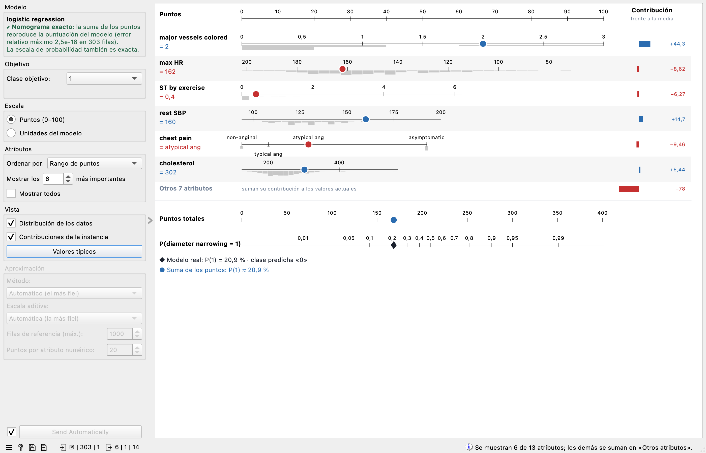
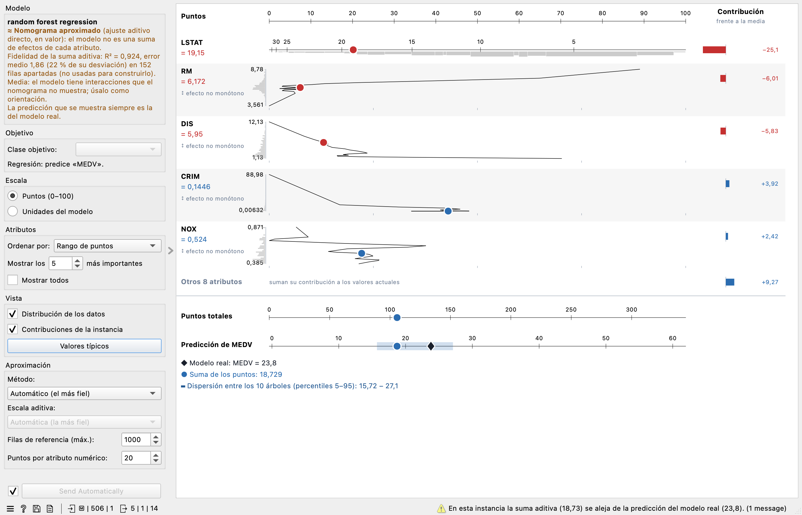

.. _nomogram pro:

Nomogram Pro
============

Muestra un modelo de clasificación o de regresión como un **nomograma**: una escala por
atributo que convierte su valor en **puntos**, y unos ejes al pie que convierten la suma de
puntos en la **predicción**. Así se ve de un vistazo qué atributos pesan más, hacia dónde
empuja cada valor y cuánto, y se puede jugar con una instancia moviendo sus valores.

Parte del widget *Nomogram* de Orange, que solo admite regresión logística y Naive Bayes, y
lo amplía a **regresión** y a **todos los modelos del panel Model**: los aditivos se dibujan
de forma **exacta** y el resto con una **aproximación aditiva** cuya **fidelidad** se mide y se
muestra siempre. La predicción que da el widget es **siempre la del modelo real**.

Entradas
--------

- **Model**: el modelo (cualquiera de clasificación o de regresión con una sola variable
  objetivo).
- **Data** (opcional): datos de referencia. Dan los rangos de las escalas, la distribución que
  se dibuja bajo cada escala, la importancia de cada atributo y, en el modo aproximado, las filas
  con las que se calcula y se mide la aproximación. Si no se conecta, se usan los datos con los
  que se entrenó el modelo, que Orange guarda con él. También se usan esos datos si *Data* tiene
  menos de 20 filas, y, para la escala de un atributo, si su columna en *Data* no tiene valores
  conocidos o (en un numérico) es constante; el widget lo dice. Si el modelo no guarda sus datos
  de entrenamiento, avisa de que la referencia no es fiable. Si *Data* no tiene ningún valor
  conocido en los atributos del modelo, la referencia son los datos de entrenamiento (con un
  aviso) o, si el modelo no los guarda, el widget da un error que lo explica.
- **Instance** (opcional): fija los valores iniciales con la **primera fila** de la tabla. Las
  columnas se emparejan por nombre; las que faltan conservan su valor.

Salidas
-------

- **Features**: los atributos que se muestran, en su orden.
- **Instance**: la instancia que se está viendo, con la clase o el valor que predice el modelo
  real. Se puede conectar a *Predictions* o a otro modelo.
- **Contributions**: una fila por atributo y una última fila **Base**, con:

  - **Puntos**: los de cada atributo **mostrado**, como en su escala (los ocultos no están en
    ninguna escala y no tienen puntos). La columna suma los *Puntos totales* del widget.
  - **Contribución** (en log-odds, en probabilidad o en unidades del objetivo): lo que el valor de
    cada atributo, mostrado u oculto, suma frente a la media; en la fila *Base*, la puntuación
    media. **Base + contribuciones = puntuación de la instancia**, la del pie.
  - **Rango de puntos**, **importancia en los datos** y, como metas, el atributo, su valor y si
    se muestra.

Qué es un nomograma
-------------------

Cada atributo tiene una escala. El valor de la instancia (el punto de color) da unos **puntos**
en el eje superior, de 0 a 100: el atributo con más efecto ocupa los 100 puntos y los demás, en
proporción. Los puntos de todos los atributos se suman en **Puntos totales**, y el último eje
convierte esa suma en la **probabilidad** de la clase objetivo (clasificación) o en el **valor
predicho** (regresión).

- **Arrastra** el punto de un atributo para cambiar su valor, o haz **doble clic en su nombre**
  para escribirlo (vacío o ``?`` lo deja como desconocido). Todo se recalcula al momento.
- El color dice si el valor sube (azul) o baja (rojo) la predicción **frente a la media** de los
  datos de referencia, y la columna **Contribución** lo cuantifica.
- Bajo cada escala, en gris, la **distribución de los datos**: un histograma en los numéricos y
  una barra por valor en los categóricos. Así se ve qué zonas de la escala tienen datos.
- **Valores típicos** pone la mediana de cada numérico y el valor más frecuente de cada
  categórico (o la instancia de la entrada *Instance*).

En el pie:

- **●** (círculo azul) es la predicción que sale de **sumar los puntos**;
- **◆** (rombo negro) es la predicción del **modelo real** para esos mismos valores;
- la **banda azul** es la incertidumbre cuando el modelo la da: la dispersión entre los árboles
  de un *Random Forest* (percentiles 5–95) o, en regresión, el error típico del modelo en los datos
  de referencia (percentiles 5–95 de los residuos; optimista si son los de entrenamiento).

Si la suma de puntos se aleja de la predicción real en la instancia que se está viendo, el widget
lo avisa.

Modo exacto y modo aproximado
-----------------------------

**Exacto.** Cuando el modelo es una suma de un efecto por atributo, el nomograma lo reproduce
sin error: la suma de puntos da exactamente la puntuación del modelo. El widget no se fía de la
teoría: lo **comprueba numéricamente** con los datos de referencia y dice el error relativo
máximo (del orden de 1e-15). Si la comprobación falla, pasa al modo aproximado y dice por qué.

- En clasificación binaria la puntuación es el **log-odds** de la clase objetivo y el eje de
  probabilidad es exacto.
- Con **más de dos clases**, la puntuación de la clase es su log-odds frente a la media de las
  demás, que sí es aditiva, pero la probabilidad depende de todas las clases. La cabecera dice
  «✔ Puntuación exacta» y el eje de probabilidad es una calibración **aproximada**, marcada como
  tal con su error medio, su percentil 95 y su error máximo en los datos de referencia. Solo se
  dibuja si es buena en casi todas las filas (error medio ≤ 0,05, percentil 95 ≤ 0,10 y máximo ≤
  0,25); si no, el pie muestra la puntuación y la probabilidad real se da debajo.
- Si el modelo no da probabilidades (SGD con pérdida *hinge*, SVM lineal), el pie muestra su
  **puntuación de decisión** y la frontera en la que cambia la clase.
- Los atributos que el modelo **discretiza** (Naive Bayes, o un *Discretize* en su preprocesado)
  se dibujan por **tramos**, como categóricos.

**Aproximado.** Para el resto de modelos (árboles, bosques, boosting, kNN, SVM con núcleo, redes
neuronales, reglas, *stacking*…) el widget construye la **mejor aproximación aditiva** que puede y
dice **cuánto se parece al modelo**:

- **Dependencia parcial**: el efecto de un valor es la predicción media del modelo cuando ese
  atributo toma ese valor y los demás se dejan como están en los datos. Se lee como «qué pasa, de
  media, al cambiar este valor».
- **Ajuste aditivo directo**: una suma de curvas suaves ajustada por mínimos cuadrados a las
  predicciones del modelo; suele ser más fiel cuando hay atributos correlacionados. Una categoría
  que no tiene ninguna fila en la muestra no tiene efecto estimado: no se dibuja (la fila lo indica
  con «sin datos») y, si la instancia la toma, cuenta como la media.
- **Automático** (por defecto) calcula los dos y se queda con el más fiel (a igualdad, la
  dependencia parcial).

Las dos se comparan con las **mismas filas apartadas**: el 30 % de la muestra de referencia se
reserva para medir la fidelidad y no se usa ni como fondo de la dependencia parcial ni para el
ajuste.

La muestra es **al azar** con una semilla fija y **no depende del orden de las filas**: la misma
tabla ordenada de otra forma (por ejemplo, por la clase) da el mismo nomograma. El fondo de la
dependencia parcial es, a su vez, una submuestra al azar de las filas de trabajo. Para que el
ajuste aditivo pueda estimar el efecto de las categorías que no salen en la muestra, añade una
fila de cada una, con el peso que les corresponde en los datos; esas filas no cuentan en la base,
la importancia ni la fidelidad, así que la muestra mantiene las proporciones de los datos.

En clasificación, la suma se hace en **probabilidad** o en **log-odds**; *Escala aditiva* lo deja
elegir y, en automático, se usa la más fiel.

Cómo leer la fidelidad
^^^^^^^^^^^^^^^^^^^^^^

El recuadro *Modelo* compara, en las filas apartadas de la muestra de referencia, la predicción de
la suma de puntos con la del modelo real:

- **R²**: la parte de la variación de las predicciones del modelo que explica la suma de puntos.
  1 es perfecto.
- **Error medio**: en probabilidad (clasificación) o en unidades del objetivo y en porcentaje de
  su desviación (regresión).
- **Misma clase**: en clasificación, en qué porcentaje de las filas la suma de puntos predice la
  misma clase que el modelo.

Con R² ≥ 0,95 la fidelidad es **alta** y el nomograma representa bien al modelo. Entre 0,8 y 0,95
es **media**: el modelo tiene interacciones (el efecto de un atributo depende de otro) que un
nomograma no puede mostrar, así que úsalo como orientación. Por debajo de 0,8 es **baja** y el
widget lo avisa: el modelo depende sobre todo de combinaciones de atributos y el nomograma solo da
una idea general. En cualquier caso, la predicción del rombo negro es la del modelo real.

Efectos que suben y bajan
^^^^^^^^^^^^^^^^^^^^^^^^^

En una escala normal, los valores se colocan donde dan sus puntos, así que una escala puede ir
al revés (de mayor a menor) o tener las marcas más juntas en una zona. Cuando el efecto de un
atributo numérico **sube y baja** con el valor, no cabe en una regla: se dibuja como una
**curva** en la que la altura es el valor (indicado a la izquierda) y la posición horizontal, sus
puntos. Arrastra el punto **en vertical** para cambiar el valor. La fila lo indica con
«↕ efecto no monótono».

Qué modelos van en cada modo
----------------------------

.. list-table::
   :header-rows: 1
   :widths: 30 15 55

   * - Modelo (panel Model)
     - Modo
     - Notas
   * - Logistic Regression
     - Exacto
     - Binaria: probabilidad exacta. Varias clases: puntuación exacta y probabilidad aproximada.
   * - Naive Bayes
     - Exacto
     - Los numéricos, por los tramos en los que los discretiza el modelo.
   * - Linear Regression (también Ridge, Lasso y Elastic Net)
     - Exacto
     -
   * - SGD
     - Exacto
     - Clasificación (con *hinge*, sin probabilidades: puntuación de decisión) y regresión.
   * - SVM con núcleo lineal
     - Exacto
     - Clasificación binaria y regresión. La probabilidad de la SVM es una calibración casi
       logística: su error medio se indica. Con varias clases, aproximado.
   * - PLS
     - Exacto
     -
   * - Scoring Sheet
     - Aproximado
     - Es aditivo en log-odds: su fidelidad sale prácticamente perfecta.
   * - Tree, Random Forest, Gradient Boosting (también xgboost y catboost), AdaBoost, kNN,
       SVM con otros núcleos, Neural Network, CN2 Rule Induction, Stack, Calibrated Learner,
       Curve Fit
     - Aproximado
     - Con su fidelidad. Random Forest añade la dispersión entre árboles.
   * - Constant
     - Aproximado
     - Predicción constante: ningún atributo tiene efecto.
   * - Cualquier modelo lineal con un preprocesado que combina atributos (PCA, atributos
       construidos)
     - Aproximado
     - El widget explica por qué no puede ser exacto.

Solo se rechazan los modelos que no tienen exactamente una variable objetivo o que no tienen
atributos. El modo aproximado necesita datos: si el modelo no guarda los de entrenamiento (por
ejemplo, uno antiguo cargado con *Load Model*), el widget pide que se conecte una tabla a *Data*.

Opciones
--------

- **Clase objetivo** (clasificación): la clase cuya probabilidad se explica. Por defecto, la
  positiva en una clase binaria («1», «yes», «sí»…, o la segunda). Cambiarla no recalcula nada.
- **Escala**: *Puntos (0–100)* o *Unidades del modelo* (log-odds, probabilidad o unidades del
  objetivo), también en la columna de contribuciones.
- **Ordenar por**: orden original, nombre, **rango de puntos** (como el *Nomogram* de Orange),
  **importancia en los datos** (cuánto varía la contribución del atributo en los datos de
  referencia) o **contribución a la instancia** actual.
- **Mostrar los N más importantes** o todos. Los que no se muestran se resumen en la fila **Otros
  atributos** con su contribución a los valores actuales: no suman puntos (los *Puntos totales*
  son los de los atributos mostrados), sino que desplazan el eje de la predicción, así que la
  predicción no cambia al mostrar más o menos atributos.
- **Aproximación**: método, escala aditiva, filas de referencia (por defecto, una muestra de
  1.000) y puntos por atributo numérico (por defecto, 20).

El nomograma se puede **guardar como imagen** (icono de guardar de la barra inferior) y añadir al
**informe**. Los valores de la instancia se guardan con el workflow.

Ejemplos
--------

**Clasificación.** *File* (heart_disease) → *Logistic Regression* → **Model** de Nomogram Pro, y
el mismo *File* → **Data**. Elige la clase objetivo «1». El nomograma es exacto: *major vessels
colored* y *max HR* son los atributos con escalas más largas; arrastra *chest pain* a
«asymptomatic» y verás subir los puntos totales y la probabilidad, que coincide con la del modelo.

**Regresión.** *File* (housing) → *Random Forest* → **Model**, y el mismo *File* → **Data** y, con
*Data Table*, una fila seleccionada → **Instance**. El nomograma es aproximado: el recuadro *Modelo*
dice su fidelidad (media en la captura) y el pie compara la suma de puntos con la
predicción real y muestra la dispersión entre los árboles.

Rendimiento
-----------

El cálculo se hace en segundo plano y se puede interrumpir en cualquier momento: el modelo predice
en trozos de medio segundo como mucho, así que cambiar de modelo o de datos, o cerrar el widget, a
mitad de un cálculo largo responde en menos de un segundo. El modo exacto tarda centésimas de
segundo. El aproximado usa una muestra de las filas de referencia y una rejilla por atributo. El
número de filas de fondo de la dependencia parcial es **fijo** para unos datos dados (unas 100.000
predicciones, algo más con muchos atributos), así que el mismo modelo con los mismos datos da el
mismo nomograma en cualquier ordenador. Solo si el modelo es tan lento que pasaría de unos 40
segundos usa menos filas, y lo avisa. Con muchos atributos usa menos puntos por atributo numérico
(al menos 8) y predice varios atributos en cada llamada al modelo.

Medido en un portátil: con 5.000 filas y 20 atributos, una red neuronal o un *Random Forest* de 100
árboles tardan menos de medio segundo; con 1.000 filas y 300 atributos, ese *Random Forest* tarda
unos 3 segundos. Con 6.000 filas de *adult*, un *Random Forest* de 500 árboles tarda unos 5
segundos, kNN entre medio segundo y 2, y una SVM con núcleo RBF, la más lenta, unos 17. Cambiar la
clase objetivo, la escala, el orden o los valores no recalcula nada.
