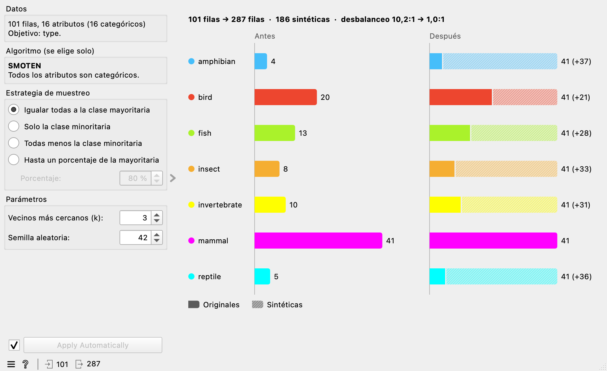

.. _smote:

SMOTE
=====

Equilibra las clases de una tabla creando instancias nuevas de las clases
con menos filas. Usa la librería `imbalanced-learn
<https://imbalanced-learn.org/>`_.

Para qué sirve
--------------

Cuando una clase tiene muchas menos filas que otra, los modelos tienden a
ignorarla. SMOTE crea filas sintéticas de esa clase: toma una fila, busca sus
*k* vecinos más cercanos **de la misma clase** y genera una fila nueva entre
ambas.

.. warning::

   Balancea solo los datos de **entrenamiento**. Si las filas sintéticas llegan
   al conjunto de prueba, la evaluación del modelo será demasiado optimista.
   Separa antes los datos con *Data Sampler*, o usa el resultado solo para
   entrenar.

Entradas
--------

- **Data**: una tabla con una variable objetivo categórica.

Salidas
-------

- **Data**: una tabla con el mismo dominio (atributos, clase y valores de las
  variables categóricas). Primero van todas las filas originales, sin cambios y
  con sus metas y pesos. Las filas sintéticas van al final.

En las filas sintéticas:

- Las **metas** quedan **desconocidas** (celda vacía): una fila inventada no
  tiene nombre, identificador ni fecha de origen.
- El **peso** es 1 si la tabla tiene pesos. SMOTE no usa los pesos y el widget lo
  avisa.

Algoritmo
---------

El widget lo elige solo según los atributos y lo indica en el panel:

.. list-table::
   :header-rows: 1
   :widths: 20 30 50

   * - Algoritmo
     - Cuándo
     - Cómo genera cada fila
   * - **SMOTE**
     - Todos los atributos son numéricos (las fechas cuentan como numéricos).
     - Interpola entre una fila y uno de sus vecinos.
   * - **SMOTENC**
     - Hay atributos numéricos y categóricos.
     - Interpola los numéricos; en los categóricos toma el valor más frecuente
       entre los vecinos.
   * - **SMOTEN**
     - Todos los atributos son categóricos.
     - Toma, en cada atributo, el valor más frecuente entre los vecinos.

Estrategia de muestreo
----------------------

.. list-table::
   :header-rows: 1
   :widths: 35 65

   * - Opción
     - Qué hace
   * - **Igualar todas a la clase mayoritaria** (por defecto)
     - Todas las clases terminan con tantas filas como la mayoritaria.
   * - **Solo la clase minoritaria**
     - Solo crece la clase con menos filas, hasta igualar a la mayoritaria. Si
       hay un empate, crece la primera según el orden de la clase.
   * - **Todas menos la clase minoritaria**
     - Crecen todas hasta la mayoritaria, salvo la de menos filas.
   * - **Hasta un porcentaje de la mayoritaria**
     - Cada clase llega al menos a ese porcentaje de la mayoritaria. Con 100 %
       equivale a igualarlas todas; una clase que ya lo supera no cambia.

Parámetros
----------

- **Vecinos más cercanos (k)**: entre cuántos vecinos se elige al generar cada
  fila. Por defecto 5. Toda clase que vaya a crecer necesita al menos *k* + 1
  filas.
- **Semilla aleatoria**: con la misma semilla, los mismos datos y las mismas
  opciones, el resultado es siempre el mismo. Por defecto 42.
- **Apply Automatically**: aplica cada cambio al momento. Si lo desactivas, el
  gráfico muestra una vista previa y la salida no cambia hasta que pulses
  **Apply**.

Gráfico
-------

Cada clase ocupa una fila con dos barras en la misma escala: **Antes** y
**Después**. La parte rayada son las instancias sintéticas y el número entre
paréntesis indica cuántas se han añadido. El titular resume las filas totales y
la razón de desbalanceo (filas de la clase mayor dividido entre las de la menor;
1,0:1 significa balance perfecto). Pasa el ratón por una fila para ver sus
números.

Mensajes
--------

.. list-table::
   :header-rows: 1
   :widths: 35 65

   * - Mensaje
     - Qué hacer
   * - No hay variable objetivo, o hay varias
     - Elige una sola con *Select Columns*.
   * - La variable objetivo es numérica
     - Conviértela con *Discretize* o *Edit Domain*, o elige otra.
   * - Solo hay instancias de una clase
     - No hay nada que balancear: revisa si un filtro anterior eliminó las demás.
   * - La clase «X» tiene menos de *k* + 1 filas
     - Baja *k* al valor que indica el mensaje, añade filas de esa clase o elige
       una estrategia que no la haga crecer.
   * - La clase «X» solo tiene una instancia
     - Añade filas de esa clase o quítala con *Select Rows*: no se puede
       interpolar con una sola fila.
   * - Valores perdidos o infinitos en los atributos
     - SMOTE no los admite. Rellénalos con *Impute* o quita las filas con
       *Select Rows*.
   * - Filas sin valor en la variable objetivo
     - Quítalas con *Select Rows* (condición «is defined» sobre la clase).
   * - La tabla no tiene filas o no tiene atributos
     - Revisa los widgets anteriores.
   * - Las clases ya están balanceadas, o la estrategia no añade nada
     - No es un error: la salida es la tabla de entrada.

Ejemplo
-------

.. code-block:: text

   File → Data Sampler → (Data Sample) → SMOTE → Test and Score (Data)
                       → (Remaining Data) ───────→ Test and Score (Test Data)

De este modo solo se balancean los datos de entrenamiento y los modelos se
evalúan con filas reales.

Referencia: N. V. Chawla, K. W. Bowyer, L. O. Hall, W. P. Kegelmeyer. *SMOTE:
Synthetic Minority Over-sampling Technique*. Journal of Artificial Intelligence
Research, 16, 321-357 (2002).
