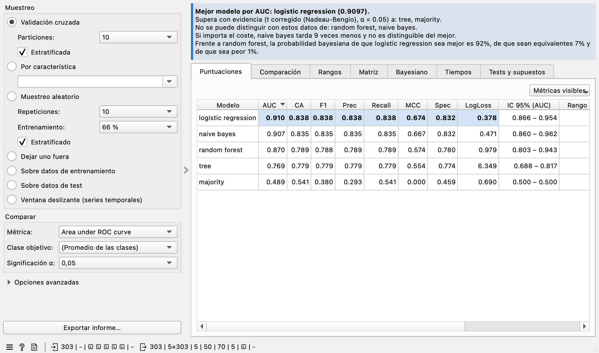
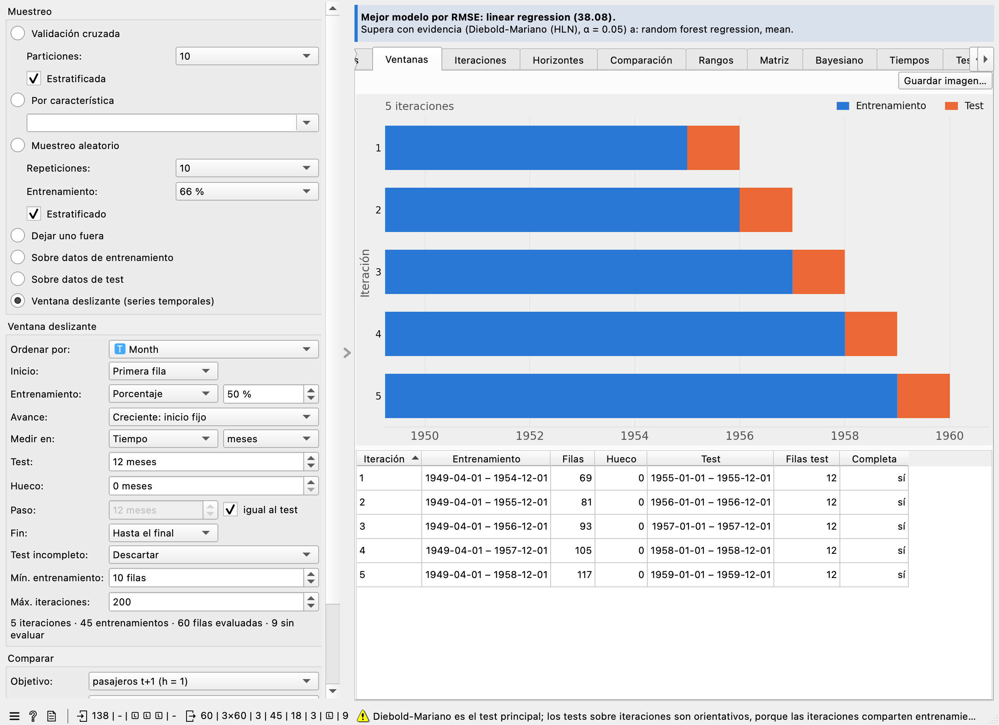
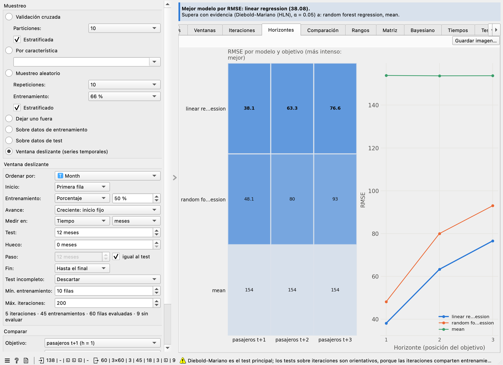

.. _test & score pro:

Test & Score Pro
================

Evalúa modelos igual que **Test & Score** y además los compara con tests estadísticos
rigurosos, gráficos y un informe exportable.

Para qué sirve
--------------

Conecta unos datos y varios modelos. El widget los entrena y evalúa, resalta el mejor
en cada métrica y responde a la pregunta importante: **¿la diferencia entre modelos es
real o puede deberse al azar?** La franja superior resume la respuesta en lenguaje
llano.

Entradas
--------

- **Data**: datos de entrenamiento, con una variable objetivo (o varias, con la ventana deslizante).
- **Test Data**: datos de test separados (opcional).
- **Learner**: uno o varios modelos.
- **Preprocessor**: preprocesado que se aplica en cada partición (opcional).

Salidas
-------

- **Predictions** y **Evaluation Results**: las mismas que Test & Score. Se conectan a
  Confusion Matrix, ROC Analysis, etc.
- **Scores**: una fila por modelo con todas las métricas, el intervalo, el rango y los
  tiempos.
- **Fold Scores**: una fila por partición y modelo; útil para Box Plot.
- **Pairwise Comparisons**: una fila por pareja y test, con estadístico, valor p, valor p
  ajustado, efecto, intervalo, probabilidades y decisión.
- **Ranks**: rango medio y posición de cada modelo.
- **Best Learner**: el modelo con mejor valor en la métrica de comparación.
- **Horizon Scores**: con la ventana deslizante, una fila por modelo y variable objetivo con todas
  las métricas y su horizonte.

Con la ventana deslizante, cada iteración es una partición de Evaluation Results, y Predictions y
Fold Scores llevan además la iteración, el inicio y el fin del entrenamiento y del test y el
objetivo.

Muestreo
--------

Los mismos métodos que Test & Score: validación cruzada, por característica, aleatorio,
dejar uno fuera, sobre datos de entrenamiento y sobre datos de test, y además la **ventana
deslizante** para series temporales (ver más abajo). Con la misma semilla
(42 por defecto) las particiones y las predicciones coinciden con las de Test & Score.

Por defecto usa **10 particiones**: con menos, los tests tienen poca potencia.

Evaluar sobre los datos de entrenamiento da puntuaciones **optimistas**, y el widget lo
avisa.

Ventana deslizante (series temporales)
--------------------------------------

Para modelos que predicen el futuro, mezclar las filas al azar es tramposo: el modelo aprendería
con datos posteriores a los que tiene que predecir. La **ventana deslizante** respeta el orden del
tiempo: en cada iteración entrena con un bloque del pasado y evalúa con el bloque siguiente.

Al elegirla aparece el recuadro **Ventana deslizante** y la pestaña **Ventanas**, que dibuja cada
iteración (azul: entrenamiento; gris: hueco; naranja: test) y la cambia al instante con cada opción.
Debajo del recuadro se ve cuántas iteraciones y entrenamientos saldrán y cuántas filas quedan sin
evaluar. Las opciones, de arriba abajo:

- **Ordenar por**: una variable de tiempo o el orden de las filas. Si los datos vienen de
  Orange3-Timeseries, se elige sola su variable de tiempo. Las filas desordenadas se ordenan y las
  que no tienen fecha quedan fuera, con aviso.
- **Inicio**: primera fila, desde la fila *N* o desde una fecha. Las filas anteriores quedan fuera
  del estudio.
- **Entrenamiento**: tamaño del primer entrenamiento, en porcentaje de las filas del estudio, en
  filas o hasta una fecha (incluida).
- **Avance**: cómo crece el entrenamiento (ver los dibujos).
- **Medir en**: filas o tiempo (segundos a años; los meses y los años siguen el calendario) para el
  test, el hueco y el paso. Todas las fechas se cuentan desde el inicio del primer test: si empieza
  un día 31, cada test empieza el último día de los meses más cortos y no se pierde ningún día.
- **Test**: tamaño de cada bloque de test, que va justo después del entrenamiento.
- **Hueco**: separación entre el entrenamiento y el test, por ejemplo para no evaluar con datos
  demasiado cercanos a los del entrenamiento.
- **Paso**: cuánto avanza la ventana en cada iteración; por defecto, lo mismo que el test. Mayor
  que el test deja filas sin evaluar; menor, tests que se solapan.
- **Fin**: hasta el final de los datos o hasta una fecha: ninguna fila posterior entra en un test.
- **Test incompleto**: si el último test no llega a su tamaño, descartarlo (todos los tests iguales)
  o usarlo más corto.
- **Mín. entrenamiento** y **Máx. iteraciones**: las iteraciones con menos filas de entrenamiento se
  omiten; si salen demasiadas iteraciones, el widget lo dice y no evalúa.

Las fechas se escriben o se eligen en un calendario, siempre dentro del rango de los datos. Las
filas con **la misma fecha nunca se separan** entre entrenamiento y test: el corte se desplaza al
final del grupo.

.. list-table::
   :widths: 33 33 34

   * - .. image:: ../../assets/ventana_creciente.png
          :width: 100%
     - .. image:: ../../assets/ventana_deslizante.png
          :width: 100%
     - .. image:: ../../assets/ventana_con.png
          :width: 100%
   * - **Creciente**: el entrenamiento empieza siempre en el mismo sitio y crece con cada iteración.
       Aprovecha toda la historia.
     - **Deslizante**: el entrenamiento conserva su tamaño y su inicio y su fin avanzan. Se adapta a
       series que cambian con el tiempo.
     - **Hueco y paso**: el hueco separa entrenamiento y test; un paso mayor que el test deja filas
       sin evaluar entre tests.

**Sin fugas de datos**: cada iteración entrena solo con su entrenamiento, y el preprocesador
conectado se ajusta también solo con él.

**Multi-horizonte**: si la tabla tiene dos o más variables objetivo (por ejemplo *y(t+1)*, *y(t+2)* y
*y(t+3)*), en cada iteración se entrena un modelo contra cada objetivo con los mismos datos de
entrenamiento y se evalúa con su test. Las demás variables objetivo nunca se usan para aprender. En
**Comparar → Objetivo** se elige el que analizan las pestañas y las salidas Predictions y Evaluation
Results; cambiarlo no vuelve a entrenar. La pestaña **Horizontes** muestra la métrica de cada modelo
con cada objetivo y cómo empeora con el horizonte. Los objetivos deben ser todos numéricos o todos
categóricos.

**Cómo se comparan los modelos**: el test principal es **Diebold-Mariano**, que compara la pérdida
de los dos modelos instancia a instancia en todos los tests, en orden temporal (la pérdida
corresponde a la métrica: error cuadrático para MSE, RMSE, R² y CVRMSE; absoluto para MAE;
porcentual para MAPE; aciertos para CA y pérdida logarítmica para LogLoss). Tiene en cuenta que los
errores de un pronóstico a *h* pasos están autocorrelacionados y usa la corrección de Harvey,
Leybourne y Newbold para muestras pequeñas. El horizonte *h* es la posición del objetivo (1 con un
solo objetivo); se puede fijar en **Opciones avanzadas → Horizonte DM**. El t corregido de
Nadeau-Bengio no se ofrece, porque supone particiones al azar; los tests sobre las iteraciones
(t, Wilcoxon, bayesiano y Friedman) se muestran como orientativos. El t bayesiano se aplica sin
correlación entre iteraciones (ρ = 0), porque con ventanas en el tiempo no hay una correlación
conocida que corregir. McNemar tampoco se ofrece: las
filas de una serie no son independientes.

La pestaña **Iteraciones** muestra la métrica de cada modelo en cada iteración a lo largo del tiempo.
Si con las opciones elegidas salen más de 2.000 entrenamientos (iteraciones × modelos × objetivos),
el widget espera a que se pulse **Evaluar**.

Pestañas
--------

- **Puntuaciones**: tabla ordenable con el mejor valor de cada métrica resaltado. Elige
  las columnas en **Métricas visibles**.
- **Ventanas**, **Iteraciones** y **Horizontes**: solo con la ventana deslizante (ver más abajo).
- **Comparación**: cada punto es una partición, el rombo el valor global y la barra el
  intervalo de confianza.
- **Rangos**: diagrama de diferencias críticas. Los modelos unidos por una barra no se
  distinguen.
- **Matriz**: fila contra columna para el test elegido. Azul: gana la fila; naranja:
  pierde; gris: sin evidencia.
- **Bayesiano**: probabilidades del mejor modelo frente a cada uno de los demás.
- **Tiempos**: entrenamiento y predicción.
- **Tests y supuestos**: todos los números, el supuesto de cada test y sus avisos.

Cada gráfico se guarda con **Guardar imagen…** en PNG, SVG o PDF. Cambiar la métrica, α
o el ROPE recalcula los tests y los gráficos **sin volver a entrenar**. Tampoco se
reentrenan los modelos que no hayan cambiado.

Cómo elegir e interpretar los tests
-----------------------------------

.. warning::

   Las particiones de una validación cruzada **no son independientes**, porque comparten
   casi todos los datos de entrenamiento. Por eso un t-test normal da demasiados falsos
   positivos. La decisión del widget se basa en el **t corregido** y, en la pestaña
   Bayesiano, en el **t bayesiano correlacionado**.

.. list-table::
   :header-rows: 1
   :widths: 22 40 38

   * - Test
     - Qué responde
     - Cómo leerlo
   * - **t corregido (Nadeau-Bengio)**
     - ¿Difieren dos modelos, teniendo en cuenta que las particiones se solapan?
       Multiplica la varianza por 1/J + n_test/n_train.
     - Es el test principal con particiones. p ajustado < α: hay evidencia de diferencia.
   * - **t emparejado sin corregir**
     - Lo mismo, suponiendo particiones independientes.
     - **Solo como referencia.** Da demasiados positivos: en una simulación con 10
       particiones, un 15 % en vez del 5 %.
   * - **Wilcoxon**
     - Versión no paramétrica, con rangos de las diferencias.
     - No supone normalidad, pero sí independencia: orientativo. Con 5 particiones o menos
       nunca alcanza p < 0,05.
   * - **Friedman, Iman-Davenport**
     - ¿Hay alguna diferencia entre todos los modelos?
     - Se concibió para varios conjuntos de datos. Sobre particiones de uno solo es
       **descriptivo**.
   * - **Nemenyi, Holm (tras Friedman)**
     - ¿Qué parejas difieren según sus rangos?
     - Misma limitación que Friedman.
   * - **McNemar**
     - ¿Aciertan dos clasificadores en filas distintas?
     - Cada fila debe predecirse una sola vez: no se ofrece con muestreo aleatorio.
   * - **t bayesiano correlacionado**
     - ¿Qué probabilidad hay de que un modelo sea mejor, de que sean equivalentes o de que
       sea peor?
     - Se decide con P ≥ 0,95. Si no, **indeciso**: no hay datos suficientes.
   * - **Por filas (error absoluto)**
     - Regresión sin particiones: compara el error fila a fila.
     - Válido con datos de test separados. En dejar uno fuera o sobre entrenamiento, con
       reservas.
   * - **Diebold-Mariano (HLN)**
     - Con ventana deslizante: ¿pronostica mejor un modelo que otro?
     - Test principal de la ventana. p ajustado < α: hay evidencia de que uno tiene menos pérdida.

**Sobre qué aporta evidencia cada test**: los tests por particiones comparan la métrica elegida.
McNemar compara los **aciertos por fila** y los tests por filas, el **error absoluto**. Si la métrica
elegida es otra (por ejemplo AUC con dejar uno fuera), su resultado no es evidencia sobre esa métrica,
y el widget lo dice.

**Orientación de las diferencias**: en las tablas, la salida y el informe, *Diferencia (A − B)* es
siempre el valor de A menos el de B, en las unidades de la métrica. En métricas de error (RMSE, MAE…)
y en rangos, una diferencia **negativa** significa que A es mejor. El efecto sigue el mismo signo. La
columna *Decisión* indica directamente qué modelo gana.

**Empates y redondeo**: dos valores que solo difieren por el redondeo del ordenador se consideran
iguales. Cada valor se compara con su propia escala y, cuando una métrica vale casi cero (por ejemplo
un ajuste perfecto), también con el error de redondeo propio de esa métrica: el de 1 en las acotadas, el
de la variable objetivo en RMSE y MAE y, en MSE, el que resulta de ese error y del valor de cada
partición. Si la diferencia entre dos modelos es constante
en todas las particiones, no hay variación con la que estimar la incertidumbre y el test es **no
evaluable**.

**ROPE** (región de equivalencia práctica): diferencia por debajo de la cual dos modelos se
consideran iguales a efectos prácticos. En automático vale 0,01 en métricas acotadas (AUC,
CA, F1…) y el 1 % de la media en métricas de error. Puedes fijarlo en **Opciones avanzadas**.

**Comparaciones múltiples**: al hacer muchas comparaciones, alguna saldrá significativa por
azar. Por defecto se ajustan con Holm; también están Bonferroni, Benjamini-Hochberg y sin
corrección.

**Tamaños de efecto**: un valor p no dice si la diferencia importa. La g de Hedges (t) y la r
biserial de rangos (Wilcoxon) la miden: insignificante, pequeña, media o grande. En McNemar, el
efecto es la razón entre las filas en que solo acierta A y aquellas en que solo acierta B.

**Intervalos de confianza**: con particiones usan la misma corrección de Nadeau-Bengio. Sin
particiones, proceden de un remuestreo de las filas.

**«No significativo» no significa «iguales»**: solo que no hay evidencia suficiente. Para
afirmar equivalencia, mira la probabilidad bayesiana de equivalencia.

Exportar el informe
-------------------

**Exportar informe…** crea un HTML autocontenido, con las imágenes incrustadas, o un PDF en A4 apaisado
con una primera página de resumen. Incluye
los datos, el muestreo y la semilla, los modelos y sus parámetros, las puntuaciones, los gráficos,
cada test con su supuesto e interpretación, y las versiones del software para reproducirlo.
También funciona el informe nativo de Orange.

Problemas habituales
--------------------

.. list-table::
   :header-rows: 1
   :widths: 40 60

   * - Situación
     - Qué hace el widget
   * - Un modelo falla
     - Los demás siguen; se indica cuál y por qué.
   * - Filas sin valor en la clase
     - Se quitan, indicando cuántas.
   * - Estratificación imposible
     - Se hace sin estratificar y se avisa.
   * - Más particiones que filas
     - Error con la solución.
   * - Métrica indefinida en una partición (AUC con una sola clase)
     - Esa partición se descarta al comparar y se indica cuántas. Las métricas que sí están
       definidas con una clase, como LogLoss, se calculan.
   * - Modelos idénticos, varianza cero o empates
     - El test lo dice en lugar de dar un número engañoso.
   * - Muy pocas particiones
     - Aviso de que la potencia es baja.
   * - Cambios en las entradas durante un cálculo
     - Se descarta el cálculo anterior.
   * - Ventana mayor que los datos o sin ninguna iteración
     - Error que dice qué reducir.
   * - Fecha fuera del rango de los datos
     - El calendario solo admite fechas dentro del rango; si una fecha deja la ventana vacía, error.
   * - Una variable objetivo sin valor en algunas filas
     - Esas filas se quitan solo de ese objetivo, con aviso.
   * - Objetivo constante o con una sola clase en un entrenamiento, o clases del test que no están
       en su entrenamiento
     - Aviso con las iteraciones afectadas; si un modelo falla, se dice en qué iteración y los
       demás siguen.
   * - Objetivos numéricos y categóricos mezclados
     - Error: sepáralos con Select Columns.
   * - Varias variables objetivo con otro muestreo
     - Error que propone la ventana deslizante.

Referencias
-----------

- Nadeau y Bengio (2003). *Inference for the generalization error*. Machine Learning 52.
- Demšar (2006). *Statistical comparisons of classifiers over multiple data sets*. JMLR 7.
- Benavoli, Corani, Demšar y Zaffalon (2017). *Time for a change: a tutorial for comparing
  multiple classifiers through Bayesian analysis*. JMLR 18.
- Diebold y Mariano (1995). *Comparing predictive accuracy*. Journal of Business & Economic
  Statistics 13.
- Harvey, Leybourne y Newbold (1997). *Testing the equality of prediction mean squared errors*.
  International Journal of Forecasting 13.
- Giacomini y White (2006). *Tests of conditional predictive ability*. Econometrica 74.
